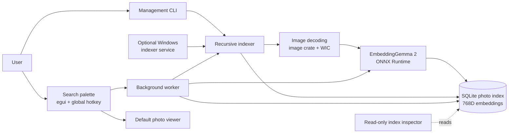
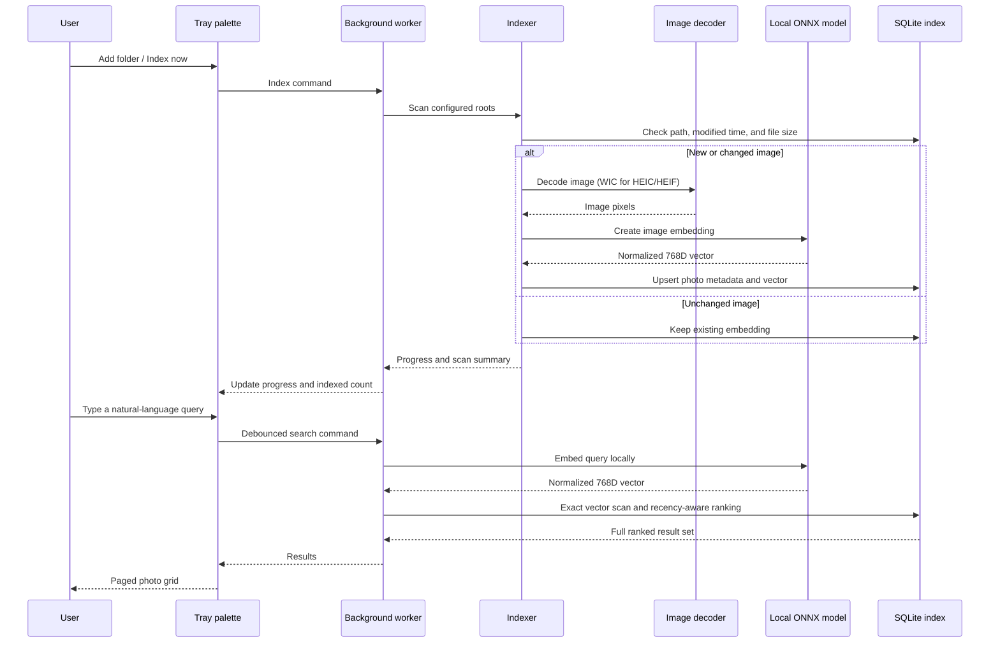

# LumenFind

LumenFind is a Windows desktop app for finding local photos with natural-language searches. Describe what you remember—such as “dog running on a snowy beach” or “person wearing glasses”—and browse matching photos from a compact search palette.

## Features

- **Semantic, multimodal search:** match text queries against local image embeddings, not just filenames.
- **Private by design:** image contents, paths, queries, and embeddings stay on this PC. The only network access is to download the pinned model files during setup.
- **Offline inference:** runs Google's quantized EmbeddingGemma 2 text-and-vision model locally with ONNX Runtime.
- **Incremental indexing:** unchanged files keep their existing embeddings; new or changed photos are indexed on the next scan.
- **Large result sets:** the palette pages through all matching indexed photos. The default page size is 24 and can be changed in `config.json`.
- **Recency-aware ranking:** semantic similarity determines relevance, with a small bounded boost for more recently modified files.
- **HEIC and HEIF:** decoding uses Windows Imaging Component (WIC); install the Microsoft HEIF Image Extensions codec, and HEVC Video Extensions if prompted.
- **Background indexing:** run the tray app, or optionally install a Windows service for periodic indexing.
- **Index Inspector:** browse the SQLite index and inspect vector records without modifying the database.

## Requirements

### To run the Windows release

- Windows 10 or 11, x64.
- Microsoft's HEIF Image Extensions (and HEVC Video Extensions if prompted) to decode HEIC/HEIF photos.
- An internet connection for the first model download. After setup, search and inference can run offline.

### To build from source

- Windows 10 or 11, x64.
- Rust 1.85 or newer with the MSVC toolchain.
- Visual Studio C++ build tools.

## Quick start

1. Download and extract the release package from `dist/LumenFind-windows-x64`.
2. Run `lumenfind-gui.exe`.
3. Select **Download EmbeddingGemma 2** on first launch. The pinned, checksum-verified model download is approximately 301 MiB.
4. Select **Add photo folder** and choose a folder to index.
5. Keep LumenFind running in the notification area. Press **Ctrl+Alt+Space** anywhere to show or hide the search palette.
6. Enter a description. Use **Previous** and **Next** above the result grid to page through matches; click a photo to open it in the default viewer.

Closing the palette hides it in the notification area. Choose **Quit** from the tray menu to exit the app.

Supported image extensions are JPEG (`.jpg`, `.jpeg`), PNG, WebP, BMP, GIF, TIFF (`.tif`, `.tiff`), HEIC, and HEIF. Animated formats use the still frame decoded by the image library.

## How search and indexing work

### Indexing

LumenFind recursively walks each configured folder without following directory symlinks. It recognizes supported extensions, records the modification time and file size, and embeds new or changed images. A complete scan removes database entries for files that have disappeared from available configured roots. A paused or partial scan does not remove files it has not visited.

Before decoding or embedding, the indexer checks each file's saved modification time and byte size. An unchanged file retains its embedding. Indexing failures are counted and written to the daily application log; the rest of the scan continues. The UI first counts supported files, then shows scan progress.

### Search and ranking

The local text model embeds the query into a normalized 768-dimensional vector. LumenFind compares it with every stored image vector using an exact cosine-similarity scan. This avoids an approximate index and keeps ranking deterministic.

More recent file modification times get a small ranking adjustment:

```text
rank = cosine_similarity + 0.02 * exp(-age_in_years / 5)
```

The maximum recency bonus is 0.02 and decays with a five-year exponential time scale. Semantic similarity remains the main relevance signal; the percentage displayed on each result is the unadjusted cosine score.

The palette fetches the full ranked result set and shows it in pages. By default, each page contains 24 photos. The command-line search prints up to the configured `result_limit`.

The tray app processes indexing and search commands on one background worker. If a scan is in progress, a search may wait until the scan yields control or finishes; the existing index remains searchable.

## Architecture



### Indexing and search flows



## Data, settings, and logs

The per-user data directory is selected with the Windows known-folder API, normally:

```text
%LOCALAPPDATA%\LumenFind\LumenFind\data
```

It contains:

| Path | Purpose |
|---|---|
| `config.json` | Photo roots, result page size, service scan interval, startup visibility, and persistent indexing pause state. |
| `photos.db` | SQLite photo metadata and normalized image embeddings. SQLite uses WAL mode. |
| `models/embeddinggemma-2-q4/` | Downloaded tokenizer and quantized ONNX model files. |
| `logs/` | Daily application log files. |

Default settings:

```json
{
  "photo_roots": [],
  "result_limit": 24,
  "scan_interval_minutes": 10,
  "start_hidden": true,
  "indexing_paused": false
}
```

`result_limit` controls the number of results per palette page and the maximum number printed by the CLI. Set it to a positive value in `config.json`, then restart the app to use the new page size. `scan_interval_minutes` is used by the optional service and is clamped to at least one minute.

## Command line

Commands use `lumenfind.exe`, included in the release package:

```powershell
# Download the pinned model files and verify their SHA-256 checksums
.\lumenfind.exe download-model

# Index all configured folders once
.\lumenfind.exe index

# Search the existing index
.\lumenfind.exe search "sunset over mountains"

# Persistently pause or resume tray and service indexing
.\lumenfind.exe pause-indexing
.\lumenfind.exe resume-indexing

# Check text and vision model inference locally
.\lumenfind.exe doctor

# Install or remove the optional Windows indexing service (elevated PowerShell)
.\lumenfind.exe install-service
.\lumenfind.exe uninstall-service
```

The CLI prints semantic similarity and photo path for each result. The optional Windows-service entry point is managed by the Service Control Manager rather than invoked directly.

## Optional Windows indexing service

The service performs periodic indexing only. Windows services run in Session 0, so the interactive per-user tray app remains responsible for the palette, global hotkey, and searching. The service and tray app use the configured photo roots and the same database.

1. Run the tray app and download the model.
2. Add and configure the photo folders.
3. Open an elevated PowerShell in the release directory.
4. Install or remove the service:

   ```powershell
   .\lumenfind.exe install-service
   .\lumenfind.exe uninstall-service
   ```

Installation copies the service executable and verified model files into `%ProgramFiles%\LumenFind`, registers the auto-start `LumenFindIndexer` service, and starts it. It requires Administrator privileges. The service interval comes from `scan_interval_minutes` in the user's configuration.

Uninstalling stops and removes the service and deletes its protected executable/model copy. It preserves user configuration, downloaded per-user model files, and the photo index.

## Index Inspector

`lumenfind-inspector.exe` is a separate, read-only viewer for the photo index. It opens the current `photos.db` by default; **Open database...** can select another compatible SQLite database. The inspector shows record paths, modification times, source sizes, vector dimensions and norms, and complete embedding details. **Refresh** reloads the snapshot. Filtering searches photo paths; selecting a row allows copying its path or opening the photo.

## Build from source

Build the GUI during development:

```powershell
cargo run --release --bin lumenfind-gui
```

Build, package, and refresh the distributable folder using the project script:

```powershell
.\scripts\build-release.ps1
```

The script runs `cargo build --release --locked`, then copies the three executables, README, MIT license, and service scripts to:

```text
dist\LumenFind-windows-x64
```

The model files are intentionally not included in the release package; the app downloads and verifies them on first use.

## Source layout

| File | Responsibility |
|---|---|
| `src/bin/lumenfind-gui.rs` | Console-free Windows tray and search-palette entry point. |
| `src/bin/lumenfind-inspector.rs` | Read-only SQLite index inspector. |
| `src/main.rs` | Management CLI, one-shot indexing/search, model setup, and service dispatch. |
| `src/ui.rs` | Search palette, global hotkey, tray menu, paged results, and background worker. |
| `src/indexer.rs` | Recursive incremental scan, supported-file discovery, progress, and cleanup of missing files. |
| `src/image_loader.rs` | Shared image loading; WIC HEIC/HEIF decoder on Windows. |
| `src/model.rs` | Pinned model download/checksum verification, preprocessing, and ONNX text/vision inference. |
| `src/db.rs` | SQLite storage, metadata freshness, exact vector ranking, and recency adjustment. |
| `src/config.rs` | Persistent application settings. |
| `src/paths.rs` | Per-user and service storage locations. |
| `src/service.rs` | Windows Service Control Manager installation and periodic background scanning. |

## Development checks

Run from the repository root:

```powershell
cargo fmt --check
cargo test
cargo clippy --all-targets -- -D warnings
```

## Privacy and licenses

Search, image decoding, embedding inference, ranking, and SQLite storage run locally. No photos, photo paths, embeddings, or text searches are sent to a remote service. The first-run model download contacts Hugging Face to fetch pinned files; checksum verification is performed before each file is accepted.

The LumenFind application is licensed under the MIT License; see [`LICENSE`](LICENSE). The downloaded EmbeddingGemma 2 model is a separate work and is subject to its own license and terms. Review the [EmbeddingGemma 2 model page](https://huggingface.co/google/embeddinggemma-2) before use or redistribution. Model files are not bundled with LumenFind.
